 

Construo sistemas de ponta a ponta: **API, banco de dados e interface**, 
para problemas reais, com código simples de manter.

 

  

---

<code>CAPÍTULO 02</code> &nbsp;·&nbsp; este perfil

  

 

<code>CAPÍTULO 01</code> &nbsp;·&nbsp; onde tudo começou

  

Perdi o acesso à conta antiga, mas o histórico continua lá → <a href="https://github.com/JulioLage-Alx"><b>@JulioLage-Alx</b></a>

  

---

feito com calma &nbsp;·&nbsp; 2026

